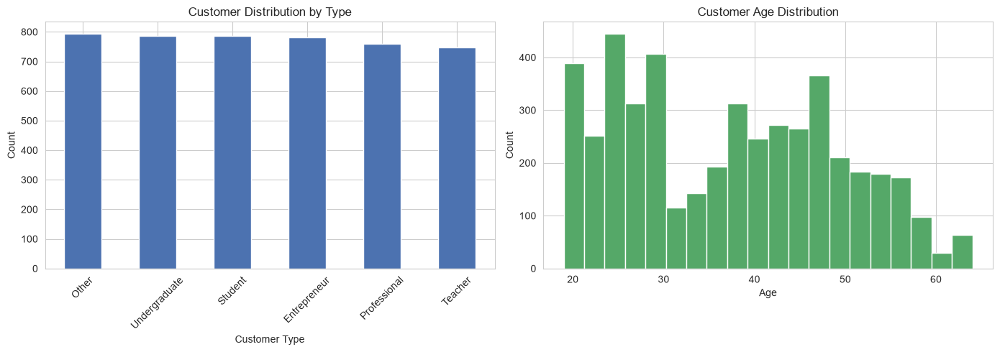
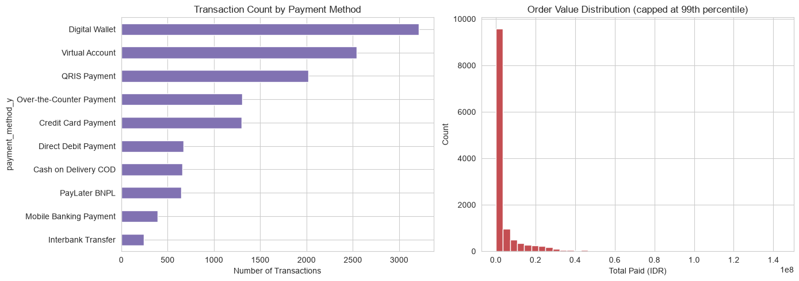
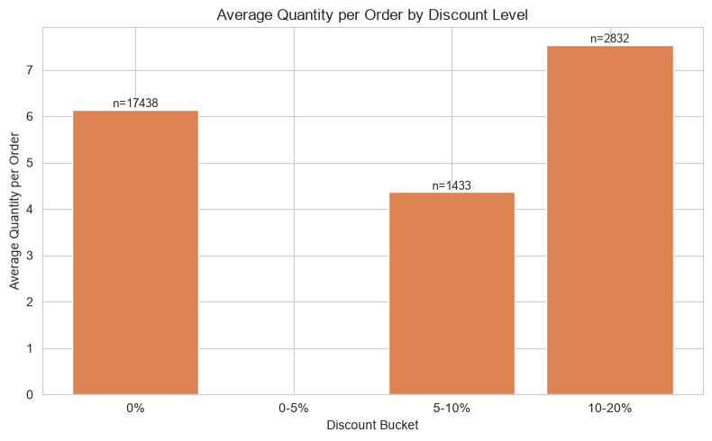
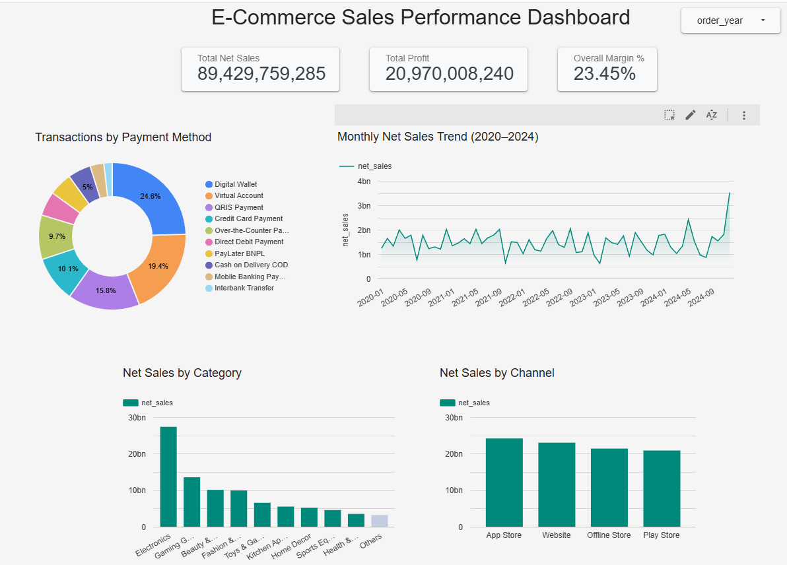

# E-Commerce Sales & Customer Behavior Analysis

A end-to-end data analysis project covering SQL querying, Python EDA, and BI dashboard — analyzing 4 years of e-commerce transaction data (2020–2024) across 6 relational tables with 21,703+ valid orders.

---

## Project Overview

This project analyzes the sales performance, customer behavior, payment patterns, and channel effectiveness of a fictional e-commerce platform ("Tokopaedi") using a multi-tool analytics workflow:

| Tool | Purpose |
|---|---|
| **PostgreSQL (Supabase)** | Data storage, relational querying, SQL VIEW for mart layer |
| **Python (Pandas, Matplotlib, Seaborn)** | Exploratory data analysis, statistical profiling, visualization |
| **Google Looker Studio** | Interactive executive dashboard |

---

## Dataset

6 relational CSV tables covering 2020–2024:

| Table | Description | Rows |
|---|---|---|
| `order_detail` | Individual order line items (SKU, quantity, price, discount, channel) | 22,812 |
| `customer_detail` | Customer demographics (age, type, province, registration date) | 4,657 |
| `product_detail` | Product catalog (SKU, category, COGS) | 5,000 |
| `transaction_detail` | Transaction-level records (payment method, total paid) | 13,000 |
| `payment_detail` | Payment method lookup table | 10 |
| `funnel_detail` | User funnel events (Viewed → Click → Add to Cart → Purchase) | 410,001 |

> **Note:** Analysis uses `is_valid = 1` filter on `order_detail`, resulting in **21,703 valid orders**.

---

## Project Structure

```
ecommerce-sales-analysis/
├── data/                          # Source CSV files (6 tables)
├── sql/
│   ├── 01_monthly_revenue_2024.sql
│   ├── 02_category_trend_2020_2024.sql
│   ├── 03_channel_growth_2024_vs_2023.sql
│   ├── 04_funnel_conversion_2024.sql
│   ├── 05_registration_and_first_purchase.sql
│   └── 06_dashboard_view.sql      # SQL VIEW as mart layer for dashboard
├── notebook/
│   └── E-Commerce_EDA.ipynb       # Python EDA notebook
├── assets/
│   ├── dashboard_preview.png
│   ├── figures/
│   │   ├── 01_customer_demographics.png
│   │   ├── 02_payment_aov.png
│   │   └── 03_discount_quantity.png
│   └── sql_screenshots/           # Query results screenshots from Supabase
└── README.md
```

---

## SQL Analysis — 5 Business Questions

All queries written in **PostgreSQL syntax**, executed and validated on **Supabase**.

### Q1: Monthly Revenue Trend 2024
> *"What does our monthly revenue trend look like in 2024?"*

**Key finding:** December 2024 was the highest-revenue month (329 transactions, ~Rp 4.1 billion) — driven by Harbolnas 12.12 and year-end seasonality.

### Q2: Category Sales Trend 2020–2024
> *"Which product categories are growing and which are declining YoY?"*

**Key finding:**
- **Food & Beverage** declined significantly (9,368 units in 2021 → 4,973 in 2024, ~-47% cumulative)
- **Books & Stationery** grew consistently every year (1,733 → 3,130+ units, 2020–2023)

### Q3: Channel Growth 2024 vs 2023
> *"Which sales channel grew the most in 2024 compared to 2023?"*

**Key finding:**
- **Offline Store** was the fastest-growing channel (+76.98% YoY)
- **App Store** was the only channel that declined (-18.14% YoY)
- **Mobile App** acquired the most new customers in 2024 (80 new registrations)

### Q4: Funnel Conversion Rate by Channel (Organic, 2024)
> *"Which channel converts traffic into purchases most effectively?"*

**Key finding:** Website had the **highest traffic** (9,486 Viewed events) but the **lowest conversion rate** (6.61%) compared to Play Store (6.80%) and App Store (6.77%) — a classic high-traffic/low-conversion pattern.

### Q5: Customer Registration & Time-to-First-Purchase
> *"How long does it take a new customer to make their first purchase?"*

**Key finding:**
- Average **86.6 days** from registration to first purchase
- **99.51%** of registered customers have made at least one purchase (4,634 of 4,657)

---

## SQL VIEW — Mart Layer for Dashboard

`06_dashboard_view.sql` creates a denormalized `dashboard_sales_detail` VIEW by joining all 4 core tables:

```sql
CREATE OR REPLACE VIEW dashboard_sales_detail AS
SELECT
    o.order_id, o.order_date, o.channel_type AS channel,
    p.category, pm.payment_method AS payment_method_label,
    o.quantity, o.before_discount AS gross_sales,
    o.discount_item AS discount, o.after_discount AS net_sales,
    p.cogs AS cogs_per_unit,
    (o.after_discount - (p.cogs * o.quantity)) AS profit_proxy,
    ...
FROM order_detail o
JOIN product_detail p ON o.sku_id = p.sku_id
JOIN transaction_detail t ON o.transaction_id = t.transaction_id
JOIN payment_detail pm ON t.payment_method = pm.id
WHERE o.is_valid = 1;
```

This mirrors a real-world **staging/mart layer pattern** — raw tables stay normalized in the database, while a transformation layer prepares a flat, ready-to-visualize table for downstream BI tools.

**Validated output:** 21,703 rows | Total Net Sales: Rp 89,429,759,285 | Overall Margin: 23.45%

---

## Python EDA — 3 Original Insights

Notebook: `notebook/E-Commerce_EDA.ipynb`
Tools: Python 3, Pandas, Matplotlib, Seaborn

### 1. Customer Demographics


Customer types are evenly distributed across 6 segments (~750–800 each). Age distribution shows a **notable spike at 23–25 years** (~450 customers), overlapping with Student/Undergraduate segments — a potential target for age-specific campaigns.

### 2. Payment Behavior & Order Value Distribution


**Digital Wallet** leads with 3,210+ transactions (~25%). Order value is **heavily right-skewed**: median Rp 1,233,418 vs mean Rp 8,110,893 — mean is distorted by high-value outliers, making **median the more representative metric** for typical customer spend.

### 3. Discount Impact on Purchase Volume


**80.3% of valid orders had zero discount.** Orders in the 10–20% discount range showed the highest average quantity per order (7.5 units vs 6.1 units with no discount) — a directional signal that deeper discounts drive larger baskets, though the sample is small and would benefit from A/B testing before scaling.

---

## Dashboard

Built in **Google Looker Studio** using the `dashboard_sales_detail` SQL VIEW exported as CSV.

🔗 [View Live Dashboard]([https://lookerstudio.google.com](https://datastudio.google.com/u/0/reporting/5cf2c968-4e8a-4b16-a5f3-d1548ed7dfcf/page/h3Z2F)



**Dashboard components:**
- 3 KPI Scorecards: Total Net Sales, Total Profit, Overall Margin %
- Monthly Net Sales Trend (2020–2024)
- Net Sales by Category (bar chart)
- Net Sales by Channel (bar chart)
- Transactions by Payment Method (donut chart)
- Interactive filter by `order_year`

---

## Key Takeaways

| Area | Insight |
|---|---|
| Revenue | December consistently peaks (Harbolnas effect); overall upward trend 2020–2024 |
| Category | Electronics dominates sales; Food & Beverage in long-term structural decline |
| Channel | Offline Store fastest-growing (+77% YoY); Website highest traffic but lowest conversion |
| Customer | 99.5% purchase rate; avg 87 days to first purchase; 23–25 age group most concentrated |
| Payment | Digital Wallet dominant (24.6%); order value median (Rp 1.2M) far below mean (Rp 8.1M) |
| Profitability | 23.45% overall margin; Toys & Games highest margin (25.1%), Sports Equipment lowest (20.7%) |

---

## How to Run

### SQL (PostgreSQL via Supabase)
1. Create a Supabase project and import all 6 CSV files from `/data`
2. Run SQL files in `/sql` folder in order (01 → 06)
3. Run `06_dashboard_view.sql` last to create the mart layer VIEW

### Python EDA
```bash
pip install pandas matplotlib seaborn
```
Open `notebook/E-Commerce_EDA.ipynb` in VSCode or Jupyter and run all cells.

> **Note:** Keep the `data/` folder in the same directory as the notebook — all CSV paths are relative.

---

## Author

**Firhan Setyo**
[GitHub](https://github.com/firhansetyo) · [LinkedIn](#) · [Portfolio](#)

*This project is an independent reconstruction of a MySkill Data Analyst Bootcamp capstone, rebuilt from scratch using the original dataset to deepen hands-on understanding of the full analytics workflow.*
